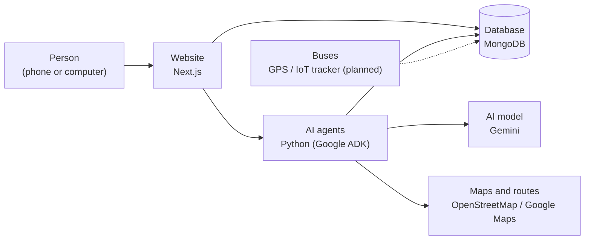

# ConnectRwanda AI

**Smart, accessible mobility for Rwanda.** ConnectRwanda AI is one platform that helps people move around Kigali and the country: live bus information, door-to-door directions, voice assistance in three languages, an accessibility map, and a free showcase for local businesses.

> Available in **Kinyarwanda, Français and English**, with dark and light themes.

---

## Table of contents

1. [The problem](#the-problem)
2. [Our solution](#our-solution)
3. [Who it is for](#who-it-is-for)
4. [Main features](#main-features)
5. [How it works](#how-it-works)
6. [Tech stack](#tech-stack)
7. [Run it on your computer](#run-it-on-your-computer)
8. [Configuration](#configuration)
9. [User roles and admin account](#user-roles-and-admin-account)
10. [Project structure](#project-structure)
11. [Project status and roadmap](#project-status-and-roadmap)
12. [Contributing, security and license](#contributing-security-and-license)

---

## The problem

Moving around Kigali is harder than it should be:

- **Passengers wait without information.** Nobody knows when the next bus arrives or which line to take.
- **People with disabilities lack reliable information** about step-free routes, accessible entrances and venues.
- **Not everyone can read a screen easily.** Many people prefer to speak and listen, in Kinyarwanda.
- **Small local businesses are invisible online** next to larger brands.

## Our solution

ConnectRwanda AI brings everything together in **one app**:

| | What it does |
|---|---|
| **Smart navigation** | Door-to-door routes on foot and by bus, drawn on a real map of Kigali. |
| **Public transport guidance** | Live bus positions and arrival times at each stop. |
| **Voice assistance** | Ask by voice and hear the answer, in Kinyarwanda, French or English. |
| **Accessible mapping** | Step-free routes and venues, confirmed by the community. |
| **Local businesses** | Free listings managed by the owners, ranked fairly. |

## Who it is for

- **Passengers and residents** who travel every day.
- **People with disabilities and older people** who need accessible information.
- **Visitors and tourists** discovering Kigali.
- **Local businesses** that want to be found.
- **Transport operators** who want a real-time view of their fleet and to inform passengers.

## Main features

- **Landing page** with an animated film, the Rwanda flag and a live map of Kigali.
- **AI chat assistant** that understands plain language ("How do I get to Kimironko market?") and answers with places and routes on the map.
- **Interactive map** (Leaflet + OpenStreetMap) with bus lines, routes and accessibility markers.
- **Voice**: push-to-talk speech to text and text to speech.
- **Secure accounts**: sign in with email + password and a 6-digit code sent by email, plus a full password reset.
- **Saved places and visit planner.**
- **Community**: share accessibility information and reviews.
- **Business space**: owners create and manage their listing (validated by an admin before it appears).
- **Admin dashboard**: users, business validation, statistics and reports.
- **Three languages** and **dark / light mode** everywhere.
- **Installable as an app** on a phone (PWA).

## How it works



1. **The person asks** a question by text or voice on the website.
2. **The AI agents** understand the request, find places and compute routes:
   - **Planner** turns the request into a clear plan;
   - **Explorer** finds the right places (database + maps);
   - **Itinerary** orders the stops and computes the routes.
3. **The answer** is shown on the map, read aloud, and can be followed step by step.

Maps work **without any paid key**: search, photos and directions fall back to free OpenStreetMap services. A Google Maps key with billing adds Google data on top.

## Tech stack

| Layer | Technology |
|---|---|
| Website | Next.js 15, React 18, Tailwind CSS, Framer Motion |
| Map | Leaflet, OpenStreetMap, OSRM routing (Google Maps optional) |
| AI agents | Python 3.12, Google Agent Development Kit (ADK) |
| AI model | Gemini (Vertex AI or free AI Studio key) |
| Database | MongoDB (local or Atlas), accessed through the MongoDB MCP server |
| Email | Nodemailer (SMTP, e.g. a Gmail app password) |
| Deployment | Docker, Google Cloud Run (see `infra/` and `deploy/`) |

## Run it on your computer

**You need:** Node.js 20+, Python 3.11 to 3.13, and a MongoDB database (local or Atlas). Works on macOS and Linux (see `SETUP_AND_CHANGES.md` for Windows).

```bash
# 1. Get the code
git clone https://github.com/Jocos12/MapForAll.git
cd MapForAll
git checkout connectrwanda-ai

# 2. Install everything (once)
./setup.sh

# 3. Fill in the two settings files it created (see "Configuration" below)
#    agents/.env  and  client/.env.local

# 4. Start
./start-all.sh
```

Then open **http://localhost:3000**.

| Command | What it does |
|---|---|
| `./start-all.sh` | Starts the database connector, the AI agents and the website |
| `./start-all.sh --build` | Same, but forces a fresh build of the website (use after big changes) |
| `./stop-all.sh` | Stops everything |

What runs on your computer:

| Port | Service |
|---|---|
| 3000 | Website |
| 8000 | AI agents |
| 3100 | Database connector (MongoDB MCP) |
| 27017 | MongoDB (only if you use a local database) |

Logs are saved in `.local-logs/`. More help and troubleshooting: **[SETUP_AND_CHANGES.md](./SETUP_AND_CHANGES.md)**.

## Configuration

Settings live in **`agents/.env`** and **`client/.env.local`**. They contain secrets, so they are **never committed** to GitHub. `./setup.sh` creates them from the `.example` files; ask the project owner for the real values.

Minimum to run:

| Setting | Meaning |
|---|---|
| `MONGODB_URI` | Address of your MongoDB database |
| `MONGODB_DATABASE` | Database name (`hodari`) |
| `MONGODB_MCP_URL` | `http://127.0.0.1:3100/mcp` |
| `HODARI_SESSION_SECRET` | A long random string |
| `PUBLIC_BASE_URL` | `http://localhost:3000` on your computer |
| `SMTP_*` | Email account used to send the 6-digit codes |

For the AI, choose one:

- **Free:** run `./set-gemini-key.sh` and paste a key from https://aistudio.google.com/apikey.
- **Google Cloud (Vertex AI):** set `GOOGLE_GENAI_USE_VERTEXAI=TRUE` and `GOOGLE_CLOUD_PROJECT`.

Optional: `./set-maps-key.sh` adds a Google Maps key.

## User roles and admin account

| Role | Can do |
|---|---|
| `client` | Use the map, chat, voice, save places, contribute |
| `business_owner` | Everything above + manage a business listing |
| `moderator` | Review community content |
| `admin` | Full dashboard: users, validations, statistics |

Create your admin account:

```bash
# in client/.env.local add:
#   ADMIN_EMAIL=you@example.com
#   ADMIN_PASSWORD=<a long password>
#   HODARI_ADMIN_EMAILS=you@example.com
cd client && npm run create-admin
```

Want demo data (demo users and places in Kigali)? Run `cd client && npm run seed:demo`.

## Project structure

```
MapForAll/
├── client/                 Website (Next.js)
│   ├── app/                Pages and API routes (login, admin, business, chat, ...)
│   ├── components/         Interface pieces (landing/ holds the ConnectRwanda AI landing and auth pages)
│   ├── lib/                Accounts, email, codes, database access, design tokens
│   └── locales/            Translations: rw.json, fr.json, en.json
├── agents/                 AI agents (Python, Google ADK)
│   └── hodari/             Orchestrator + Planner, Explorer, Itinerary agents and their tools
├── infra/, deploy/         Cloud deployment files
├── firmware/, hardware/    Bus tracker (GPS / IoT) work
├── docs/                   Architecture and project documents
├── setup.sh                One-time installation
├── start-all.sh            Start everything
└── stop-all.sh             Stop everything
```

> The repository is still named **MapForAll**, and some internal names use **Hodari** (the original project). The product is now **ConnectRwanda AI**.

## Project status and roadmap

**Working today (prototype):** landing page, accounts with email codes and password reset, AI chat with places and routes, interactive map, voice, accessibility map, business listings, admin dashboard, three languages.

**Next steps:**

- **0 to 3 months:** user tests, accessibility mapping, improve the prototype.
- **3 to 6 months:** GPS / IoT pilot on one bus line with a transport operator.
- **6 to 12 months:** mobile app, more bus lines, more cities in Rwanda.

## Contributing, security and license

- How to contribute: [CONTRIBUTING.md](./CONTRIBUTING.md)
- Code of conduct: [CODE_OF_CONDUCT.md](./CODE_OF_CONDUCT.md)
- Report a security issue: [SECURITY.md](./SECURITY.md)
- License: [Apache 2.0](./LICENSE)

**Team:** Mindset Alliance SARL · Project code A27
